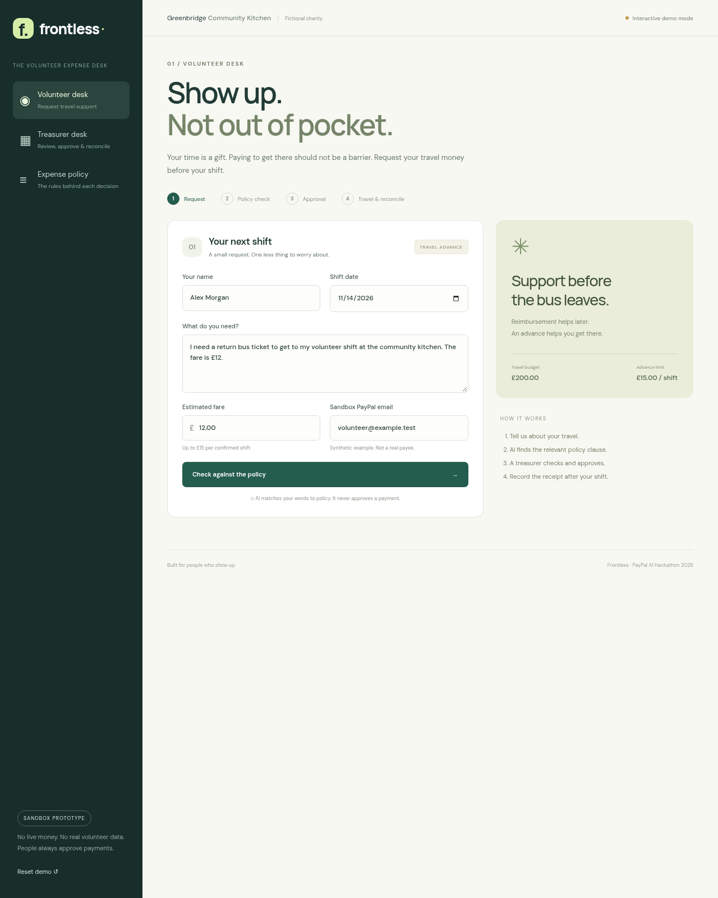
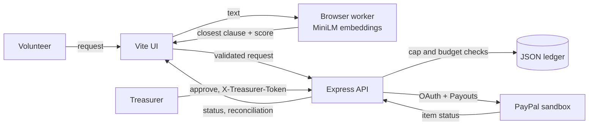
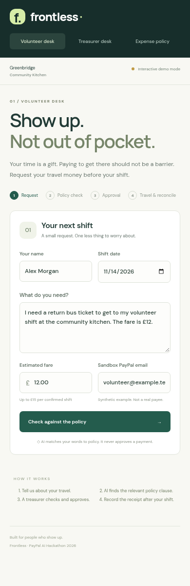

# Frontless

**Show up. Not out of pocket.**

[](https://github.com/SayedZahur786/frontless/actions/workflows/ci.yml)
[](LICENSE)


Frontless turns a volunteer's travel request into a policy cited, human approved travel advance, then records what was actually spent. It was built for the PayPal AI Hackathon.

[Live demo](https://frontless-volunteer-advance.surge.sh/) | [Full sandbox app](https://frontless-e640.onrender.com/) | [Demo video (1:24)](https://youtu.be/3loSsYoZxIM) | [Devpost entry](https://devpost.com/software/frontless)



## TL;DR

- **Problem:** volunteers who cannot afford to pay for travel first often do not volunteer at all, and treasurers check each claim by hand.
- **What Frontless does:** a browser model finds the policy clause closest to the request, code enforces the cap and budget, a treasurer approves, and a PayPal sandbox payout is prepared. A receipt is reconciled afterwards.
- **Proof, stated plainly:** 9 unit tests pass in CI, the AI runs for real in the browser, and the PayPal sandbox accepted a Payouts request (HTTP 201, `PENDING`, simulator only). No real money moved. See [Limitations](#limitations).

## The problem

Many people who want to volunteer cannot afford to travel to a shift first and wait for a refund. Charities usually reimburse after the fact, so the people with the least spare cash carry the up front cost. Treasurers, who are often volunteers themselves, then check each claim by hand against a policy.

Frontless targets small charities with a written travel policy and a part time treasurer. It shortens one step: matching a request to the policy and preparing a payment for a person to approve.

## How it works

1. **Request.** A volunteer describes the fare and a confirmed shift.
2. **Policy match.** A sentence transformer running in the browser embeds the request and three policy clauses, then shows the closest clause and its cosine similarity.
3. **Rule check.** Plain code enforces the 15 GBP per shift cap and the charity budget. The AI never decides how much to spend.
4. **Human approval.** A treasurer verifies the shift, payee, amount, policy and budget, then approves.
5. **Advance and receipt.** The Node backend sends a PayPal sandbox Payouts batch with a stable `sender_batch_id`. After the trip, a receipt total is reconciled. For example, 12.00 advanced and 11.20 spent leaves 0.80 to return. That is recorded as outstanding. It is not a refund and nothing is debited automatically.

## One worked example

| Step | What happens |
| --- | --- |
| Request | "I need a return bus ticket to get to my volunteer shift at the community kitchen. The fare is 12 GBP." |
| Policy match | The closest of three clauses is shown with its cosine similarity. The score is a hint for the treasurer, not a decision. |
| Rule check | 12.00 is within the 15.00 per shift cap and the 200.00 budget, so the request can go forward. A 20.00 request is rejected by code. |
| Approval | The treasurer confirms. In the sandbox app a Payouts batch is sent. In the static demo the step is simulated. |
| Receipt | 11.20 spent against 12.00 advanced leaves 0.80 return outstanding, recorded only. |

## Architecture



- Vite and plain JavaScript front end
- `@huggingface/transformers` in a dedicated worker, using the quantized `Xenova/all-MiniLM-L6-v2` model with mean pooling, L2 normalization and cosine similarity
- Node.js and Express backend, native `fetch` for PayPal OAuth and Payouts
- Integer penny money arithmetic, stable payout batch IDs, audit events
- No paid AI API, no generative policy extraction, no receipt OCR

The model does semantic retrieval. Its score is not a probability, and it is not legal or compliance advice. A caller cannot use an AI result to bypass the server side amount or budget checks.

## Demo

[](https://youtu.be/3loSsYoZxIM)

The static demo on Surge runs the AI in your browser. With no backend configured, approval and receipt steps are clearly labelled as simulated and no payout is sent. It asks for no credentials.

<p align="center"></p>

## Quick start

Requires Node.js 20 or newer and npm. Tested with Node 22.

```sh
git clone https://github.com/SayedZahur786/frontless.git
cd frontless
npm ci
npm test
npm run build
npm start
```

Open http://localhost:3000. Without sandbox credentials the front end stays in labelled demo mode. The model downloads on the first check, so allow a short first run wait. Later runs use the browser cache. If the model cannot load, the app shows an error instead of an invented answer.

## PayPal sandbox setup

1. Create a REST app in the PayPal Developer dashboard (sandbox).
2. Fund a sandbox Business sender and create or use a sandbox Personal receiver. Make sure the app has Payouts access.
3. Configure the environment:

```sh
cp .env.example .env
# PAYPAL_CLIENT_ID=your sandbox app client ID
# PAYPAL_CLIENT_SECRET=your sandbox app secret
# TREASURER_TOKEN=a long, private token you choose
npm run build
node --env-file=.env server/index.js
```

- Never commit `.env`. Use the personal sandbox receiver email instead of `volunteer@example.test`.
- The UI asks for `TREASURER_TOKEN` on the first backend request and keeps it in memory only. Never type a PayPal secret into that box.
- The prototype uses GBP throughout. The sender and receiver need GBP support and a test balance.
- Errors can mean missing Payouts permission or an unfunded sender. A timeout is not proof of failure. Check the sandbox dashboard before retrying.

### Smoke test

```sh
node --env-file=.env scripts/smoke-paypal.mjs
```

This sends PayPal's documented `POSPYO001` test value to the sandbox Payouts endpoint. It is a USD 1.00 response simulation, separate from the GBP travel flow. See [PayPal's test values guide](https://developer.paypal.com/api/payouts/test-go-live).

**Recorded result.** On 13 November 2026 the smoke test returned HTTP 201, batch ID `83TEPJXBQJXZE`, status `PENDING`. That shows OAuth and the Payouts request worked against the sandbox. It is simulator evidence. It is not a completed transfer and not proof a volunteer received money.

## API

The backend serves the built front end and these routes on one origin. Data changing routes and private reads require `X-Treasurer-Token`.

| Route | Purpose |
| --- | --- |
| `GET /api/health` | Sandbox and configuration status, synthetic policy |
| `GET /api/requests` | List requests (treasurer token) |
| `POST /api/requests` | Validate name, email, date, description and the 15 GBP limit |
| `POST /api/requests/:id/approve` | Human confirmation, budget check, sandbox payout |
| `GET /api/requests/:id/status` | Fetch the latest PayPal payout item status |
| `POST /api/requests/:id/reconcile` | Record the actual receipt total after payout status is confirmed |

OAuth credentials stay on the server and are used only against `https://api-m.sandbox.paypal.com`.

## Tests

```sh
npm test
```

Unit tests cover money parsing, malformed input, the policy cap, recipient validation and reconciliation. CI runs install, tests and build on every push and pull request. Browser checks of the AI run, the simulated approval flow, reconciliation and mobile widths were done manually and are not part of CI.

## Hosting

- `dist/` can be served by any static host for the browser AI demo.
- `render.yaml` is a Render web service blueprint. Set the two PayPal sandbox secrets there. The generated treasurer token must stay private.
- Render's free disk is ephemeral, so the JSON ledger can be lost on restart or redeploy.

## Limitations

This is a sandbox prototype, not a payments product.

- All people, charity policies and data are synthetic. There are no pilots, customers or validated willingness to pay.
- The only PayPal evidence is the response simulator result above. No real money moved.
- In the hosted static demo, approval is simulated.
- No identity verification, volunteer authentication, durable shared ledger, rate limiting, receipt validation, return payment flow or autonomous disbursement.
- Receipt totals are entered by hand. A production version would need a database with locking and idempotency recovery, a data protection review, and approval of the policy and payment flow by the charity.

## Evidence behind the problem

- [NCVO, Time Well Spent 2023](https://www.ncvo.org.uk/news-and-insights/news-index/time-well-spent-2023/volunteering-barriers-enablers/): dated GB research, not a market size estimate
- [Financial help to support volunteering](https://peervols.russellwebster.com/financial-help-to-support-volunteering/): accounts of up front cost barriers
- [PayPal Payouts API](https://developer.paypal.com/docs/api/payments.payouts-batch/v1/)
- [all-MiniLM-L6-v2 model card](https://huggingface.co/Xenova/all-MiniLM-L6-v2)

## License

MIT, see [LICENSE](LICENSE). The model and third party dependencies keep their own licenses.
